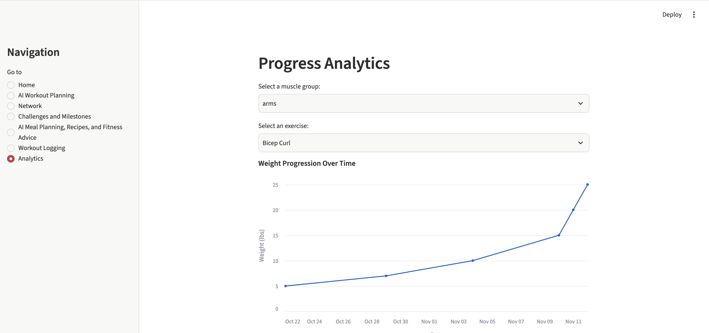
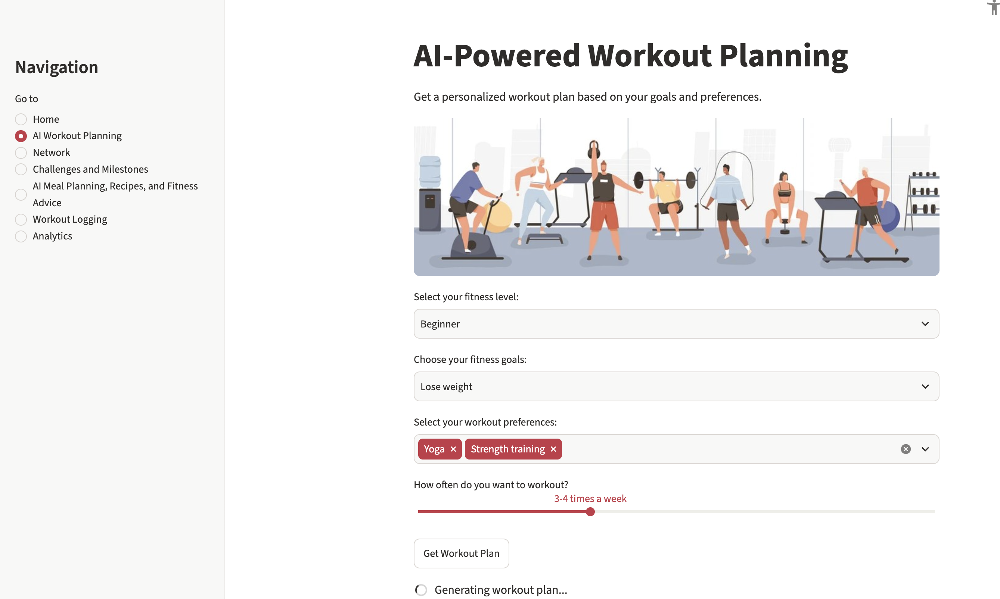
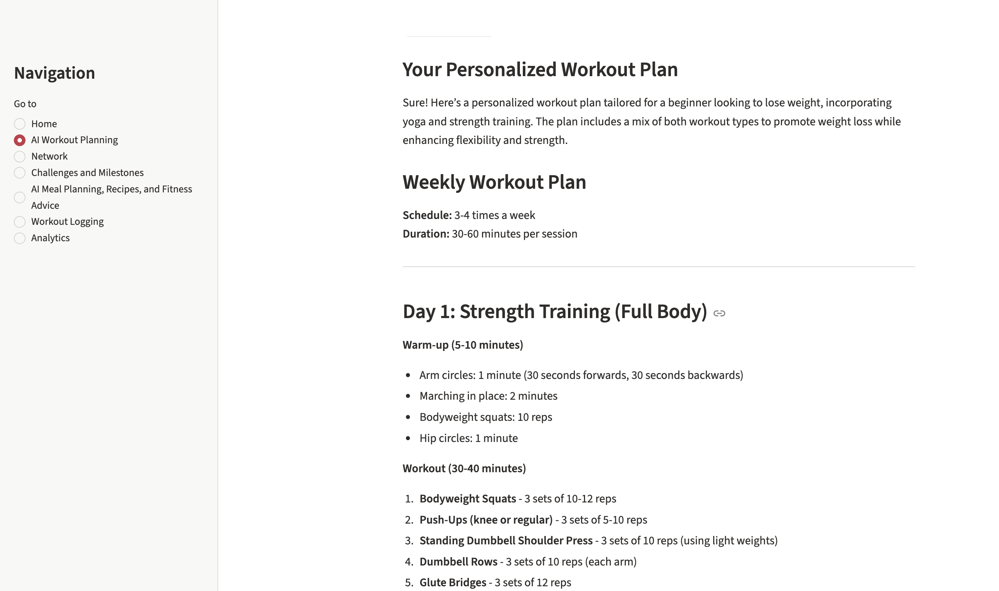
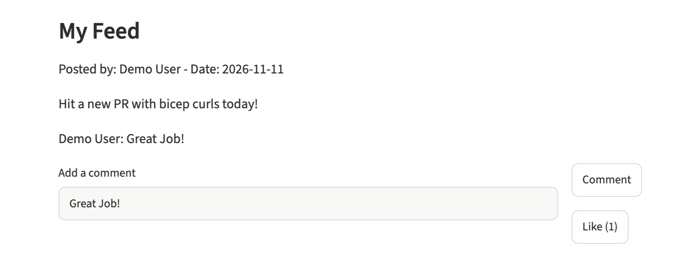
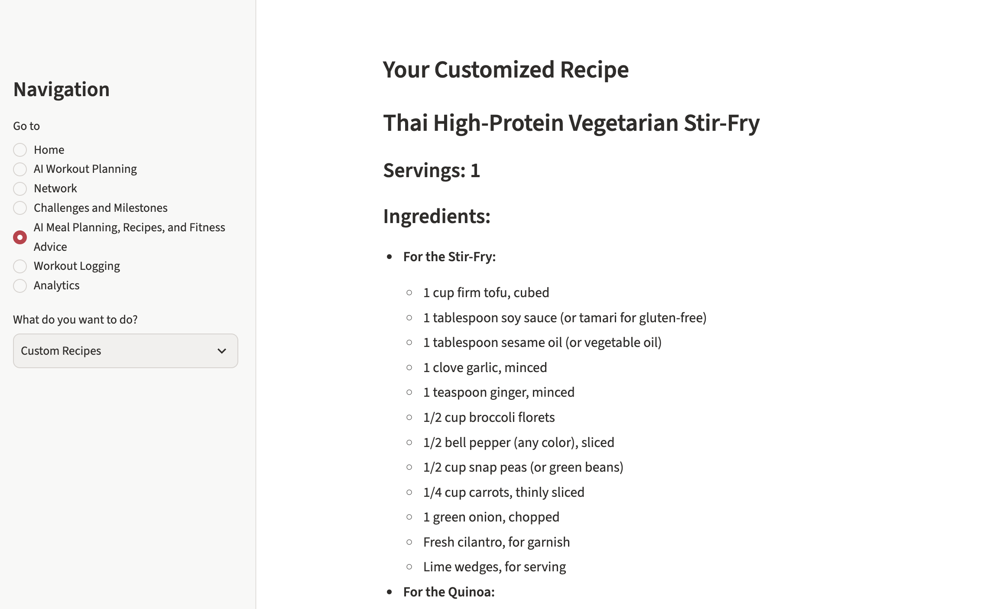

# SociallyFit

An AI-powered fitness app that combines personalized workout and meal planning, workout tracking with progress analytics, and a social feed to keep you motivated with friends.

Built with **Python**, **Streamlit**, the **OpenAI API**, and **SQLAlchemy + SQLite**.



## Features

- **AI Workout Planning**: generates a personalized weekly plan from your fitness level, goals, workout preferences, and training frequency.
- **AI Meal Planning & Recipes**: builds custom recipes and meal plans, plus a chat-style FitnessBot for nutrition and training questions.
- **Workout Logging**: log exercises with sets, reps, and weight, either manually or by picking from an exercise library ([API Ninjas](https://api-ninjas.com/api/exercises)), and browse past workouts by date.
- **Progress Analytics**: interactive Altair charts of weight, set, and rep progression for each exercise over time.
- **Social Network**: post updates, like and comment on posts, and manage friends and friend requests.
- **Challenges & Milestones**: track fitness challenges and goals.

## Screenshots

| AI workout planning | Generated plan |
|---|---|
|  |  |

| Social feed | AI meal planning |
|---|---|
|  |  |

## Tech Stack

| Layer | Tools |
|---|---|
| Frontend / UI | Streamlit, Altair |
| AI | OpenAI API (`gpt-4o-mini`) |
| Data | SQLAlchemy ORM, SQLite |
| External APIs | API Ninjas Exercises API |
| Config | python-dotenv |

## Getting Started

**Prerequisites:** Python 3.10+

```bash
# 1. Clone the repo
git clone https://github.com/anvi-gari9/sociallyfit.git
cd sociallyfit

# 2. Create a virtual environment and install dependencies
python3 -m venv .venv
source .venv/bin/activate        # Windows: .venv\Scripts\activate
pip install -r requirements.txt

# 3. Add your API keys
cp .env.example .env
# then edit .env and fill in OPENAI_API_KEY (and optionally API_NINJAS_KEY)

# 4. Run the app
python -m streamlit run main.py
```

The app opens at `http://localhost:8501`. The SQLite database (`sociallyfit.db`) is created automatically on first run.

**API keys**
- `OPENAI_API_KEY` (required for the AI pages): get one at [platform.openai.com](https://platform.openai.com/api-keys).
- `API_NINJAS_KEY` (optional): powers the "Fetch Exercises" lookup. Manual exercise entry works without it.

## Project Structure

```
├── main.py                    # App entry point and sidebar navigation
├── database.py                # SQLAlchemy models (User, Post, Comment, Workout) and data helpers
├── ai_workout_planning.py     # AI-generated workout plans
├── ai_recipe_meals.py         # AI recipes, meal plans, and FitnessBot chat
├── workout_logging.py         # Workout logging and history
├── analytics.py               # Progress charts
├── social_network.py          # Feed, posts, comments, likes, friends
├── challenges_milestones.py   # Challenges and milestones
├── images/                    # App images and README screenshots
├── requirements.txt
└── .env.example               # Template for required environment variables
```

## Design Notes

- **Single data layer.** The original version stored workouts in Firebase Firestore and social data in SQLite. I consolidated everything into one SQLAlchemy/SQLite layer, which removed the cloud dependency and lets the app run locally with no external setup beyond API keys.
- **Secrets in environment config.** All API keys are loaded from a git-ignored `.env` file via `python-dotenv`, with a committed `.env.example` documenting what's needed.
- **No authentication yet.** The app runs as a single demo user (`CURRENT_USER` in `social_network.py`); friends and friend requests use mock data.

## Roadmap

- User accounts and authentication
- Persist friends and friend requests in the database
- Unit tests for the data layer
- Deploy to Streamlit Community Cloud

## Credits

Originally built as a project for a Georgia Tech course (Summer 2024). Later refactored and maintained by Anvita Garikiparthi.
